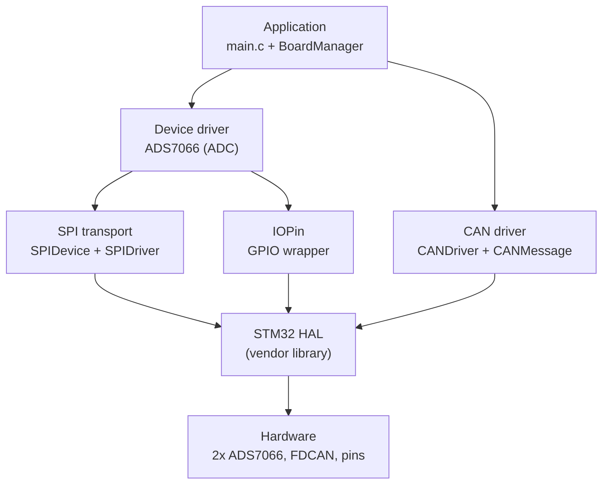
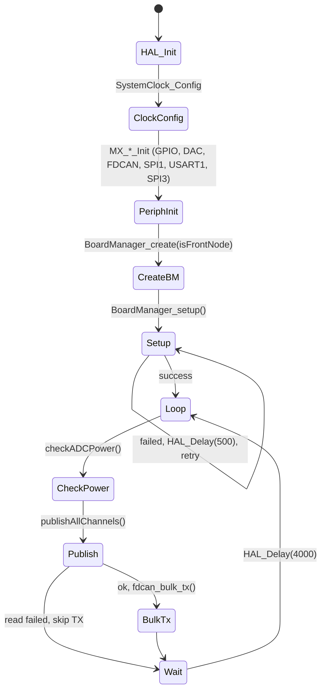
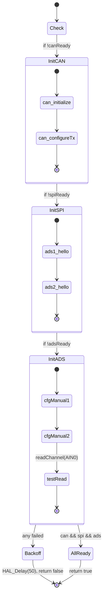
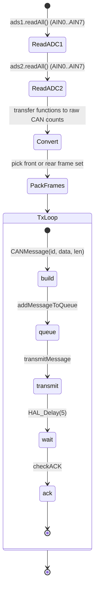
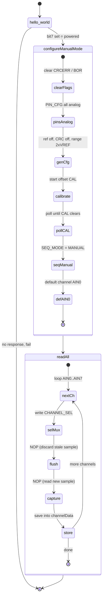
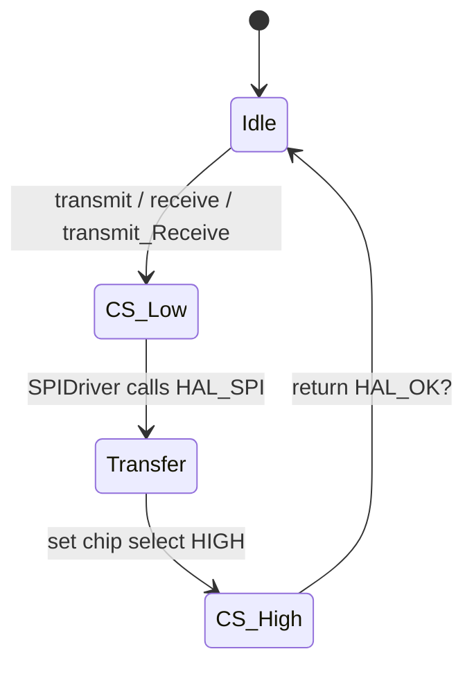
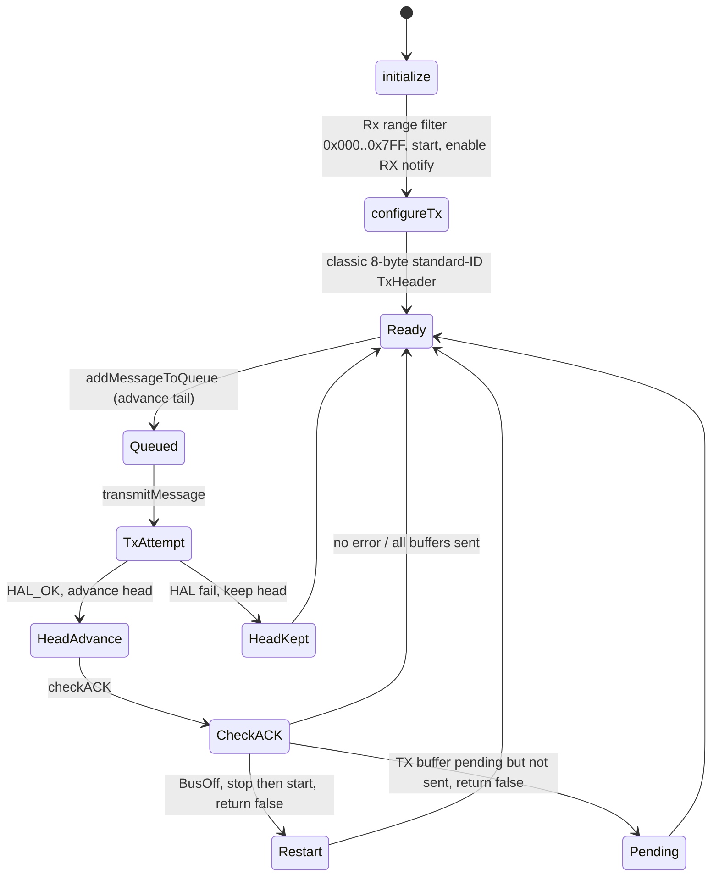

# MFE26 CAN Nodes: A Friendly Walkthrough

*A gentle tour of the MFE26 sensor node firmware for anyone new to the codebase, to CAN, or to SAR ADCs. Start here.*

## What is this?

This is the firmware for the sensor nodes on McGill Formula Electric's 2026 car. Each node is a small STM32 board that reads a handful of analog sensors (temperatures, brake-line temps, suspension angles), turns those raw readings into real physical units, and broadcasts them onto the car's **CAN bus** so the rest of the car's electronics can use the data.

There are two physical boards, a **front** node and a **rear** node, and here's the fun part: they run the exact same source code. Which role a board plays is decided at build time by flipping a single flag before you flash it.

A bit of jargon up front so nothing trips you up later. **CAN** is the small, tough two-wire network that ties all of the car's electronics together. Everybody shares one bus, and every message carries a numeric **ID**. **DLC** stands for "Data Length Code," which is just a fancy name for how many bytes a frame carries (8 at most here).

## The big picture

Here's what the board actually does, start to finish:

- **Boot and init.** Bring up the chip and its peripherals (CAN, SPI, UART).
- **Read sensors.** Two analog-to-digital converters (ADCs) each sample 8 channels over SPI.
- **Convert.** Turn raw ADC counts into physical units (°C, degrees), then pre-scale them so a receiver only has to apply the DBC formula.
- **Broadcast.** Send the values out as CAN frames, wait about 4 seconds, and do it all again forever.

The code is split into clean layers, and each layer only ever talks to the one directly below it:



The way to read that: the **application** decides *what* to read and *when* to send it. The **drivers** know *how* to actually talk to a specific chip or bus. And the **HAL** (Hardware Abstraction Layer, which is STMicro's vendor code) does the raw register pokes so nobody above it has to.

## Hardware at a glance

- **MCU:** STM32G491RETx, an ARM Cortex-M4. Everything is set up in STM32CubeIDE / CubeMX (`MFE27-CAN-Node.ioc`).
- **Two TI ADS7066 ADCs** on **SPI1**. They share the clock and data lines (SCK/MISO/MOSI), but each one gets its own **chip select**, the pin that basically says "I'm talking to *you* right now." ADC 1 is `ADC_CS1` (PB10), ADC 2 is `ADC_CS2` (PB9).
- **CAN:** FDCAN1 on PA11/PA12, classic CAN, 8-byte frames, running at **1 Mbit/s** (`NominalPrescaler = 5` with TimeSeg1 13 and TimeSeg2 2 on an 80 MHz FDCAN clock, so 80e6 / (5 × 16) = 1 Mbit/s).
- **UART:** USART1 (PC4/PC5) at 115200 8N1, used purely for `printf` debug output.
- **Two roles, one binary:** in `main.c`, `bool isFrontNode = 1;` picks front (`1`) or rear (`0`). It's a compile-time choice, so make sure you flash the right build to the right board.

## How the application runs

### Top level (`main.c`)

`main()` brings up the chip, builds one `BoardManager`, keeps retrying setup until it actually works, and then loops forever on a roughly 4-second cycle.



A couple of things are worth calling out. First, the result of `checkADCPower()` is logged but not acted on, so a failing power check won't stop the loop. Second, if `publishAllChannels()` can't read a channel, that cycle quietly skips the CAN transmit and just waits for the next one.

### Inside the BoardManager

`BoardManager::setup()` keeps trying to bring up three subsystems (CAN, SPI, and the ADCs). Each one is guarded, so anything that's already working never gets redone. If any step fails, it backs off for 50 ms and returns `false`, which lets `main` come back and try again.



Once everything is up, publishing is a simple, predictable sequence:



The sensor conversions live in `BoardManager.cpp`, and they do two jobs at once. They convert raw ADC counts into a physical value, and then they pre-scale that value into DBC raw counts by applying the inverse of the DBC factor and offset. The payoff is that a receiver never has to know anything about the sensor: it just applies `factor` and `offset` and gets engineering units back.

| Function | Sensor | Physical output | Pre-scaled to (factor/offset) |
| --- | --- | --- | --- |
| `KTY84_function` | KTY84 thermistor | temperature °C | 0.1 / -40 |
| `GE1711_function` | brake-line thermistor (Steinhart-Hart beta model) | temperature °C | 0.1 / -40 |
| `RE22_function` | rotary potentiometer | angle 0 to 360° | 0.01 / 0 |
| `INFKL800_function` | IR brake-rotor sensor (5 mV/°C linear) | temperature °C | 0.1 / 0 |

## The driver layers

### ADS7066 ADC driver

The ADS7066 is a 16-bit, 8-channel **SAR ADC**. SAR stands for "Successive Approximation Register," which is just a way of saying that to digitize a voltage it guesses one bit at a time, from the most significant bit on down, comparing against the input at each step. If that sounds like a binary search for the voltage, that's exactly what it is.

The firmware runs the chip in **manual mode**, meaning *we* choose which input channel to read. A **mux** (a multiplexer, basically an electronic selector switch) routes one of the 8 analog pins into the converter, and then we read the result. The chip talks over 3-byte SPI frames using three opcodes: `RD_REG` to read a register, `WR_REG` to write one, and `NOP` to do nothing but clock data out.

There's one subtle detail in `readChannel()` that's easy to miss. Right after you switch the mux, the chip's output register still holds the *previous* channel's sample. So the driver sends one `NOP` frame to flush that stale value out, then a second `NOP` frame to actually capture the freshly selected channel.



A few notes on the methods:

- `hello_world()` reads `SYSTEM_STATUS` and checks bit 7. If it's set, the chip is powered and responding. This gets used both at init and as the periodic power check later on.
- `readAll()` is nothing fancy; it just loops `readChannel()` over AIN0 through AIN7.
- There's also an **autonomous mode** (`configureAutonomousMode` and `readChannelAuto`), where the chip scans channels on its own. It's fully implemented, but the main loop doesn't use it today.

### SPI transport

SPI is the synchronous serial link between the MCU and the ADCs. This layer is deliberately thin, and it's split into two small pieces:

- **`SPIDevice`** owns a chip-select pin. Every transaction pulls chip select **LOW** (which selects the chip), does the transfer, and then sets it **HIGH** again to release it. Because each ADC has its own `SPIDevice` with its own CS pin, both chips can safely share the same bus wires.
- **`SPIDriver`** is a straight wrapper over the STM32 HAL SPI calls (`HAL_SPI_Transmit`, `Receive`, and `TransmitReceive`), returning `true` on `HAL_OK`.



`IOPin` is thinner still. It's a tiny GPIO helper whose `setPin()` is basically just `HAL_GPIO_WritePin`, and it's what `SPIDevice` uses to wiggle the chip-select line.

### CAN driver

`CANDriver` wraps the STM32 FDCAN peripheral, which we've configured for classic CAN. Outgoing messages go through a software **ring-buffer queue**, and the important trick is that the queue head only advances when the hardware actually accepts the frame.

One more piece of jargon: **bus-off** is a protective state the CAN controller drops into after too many transmit errors, which usually means nobody else is on the bus to acknowledge the message. In that state it shuts down transmission until it gets restarted.



Walking through the key methods:

- `initialize()` sets up an Rx **range filter** that accepts IDs `0x000..0x7FF` into RX FIFO0, rejects anything that doesn't match (and remote frames too), starts FDCAN, and turns on the new-message notification.
- `configureTransmission()` builds a reusable classic-CAN, 8-byte, standard-ID transmit header.
- `transmitMessage()` calls `HAL_FDCAN_AddMessageToTxFifoQ`. If that fails, it keeps the queue head where it was instead of advancing it, so nothing gets silently dropped.
- `checkACK()` reads the protocol status and error counters, prints what the last error code means (0 is no error, 3 is an ACK error meaning no node acknowledged, 6 is a CRC error, and so on), restarts FDCAN if it sees bus-off, and reports failure if any TX buffer is still pending but hasn't actually transmitted.
- `transmitPriorityMessage()` is a placeholder for now and isn't implemented yet.

## The DBC file explained

The file `sil/evidence/controlling.dbc` is a tracked, portable copy of the car's CAN database. A **DBC** (short for Vector CAN database) is just a plain-text file that describes every CAN message and every signal packed inside it. That's what lets any tool or receiver on the bus decode the same bytes the same way. Think of it as the shared contract for the whole network.

Reading the syntax is easier with a real example in front of you:

```text
BO_ 200 Front_ThermistorTemps: 8 FrontNode
 SG_ Temp1 : 0|12@1+ (0.1,-40) [-40|180] "degC"
```

- The first line is a **message** (`BO_`) with ID `200`, named `Front_ThermistorTemps`, `8` bytes long, sent by the node `FrontNode`.
- The second line is a **signal** (`SG_`) named `Temp1`. Reading left to right: it starts at bit 0, is 12 bits wide, `@1` means little-endian, `+` means unsigned, `(0.1,-40)` is the factor and offset, `[-40|180]` is the valid range, and `"degC"` is the unit.

That factor and offset is the heart of how the two sides stay in sync. The firmware pre-divides so the value already on the wire is a raw count, and the receiver multiplies back out:

```text
raw = (physical - offset) / factor        (firmware, when packing)
physical = raw * factor + offset          (receiver, when decoding)
```

So a thermistor reading of 25 °C becomes `(25 - (-40)) / 0.1 = 650` on the bus, and the receiver turns that `650` back into `650 * 0.1 + (-40) = 25 °C`. Same number, no coordination needed beyond the DBC.

The `BU_` line lists the nodes in the file: `FrontNode`, `RearCAN`, `RideHeight`, `VehicleController`, and `AccelNode`. This firmware only implements the `FrontNode` and `RearCAN` sensor frames. The DBC also defines plenty of other messages for the rest of the car (ride height, accelerometers, cooling, tire IR temps, load cells) that belong to other ECUs.

Here are the messages this firmware actually sends:

| Role | ID | Name | Contents |
| --- | --- | --- | --- |
| Front | 200 | Front_ThermistorTemps | 4x KTY84 temps |
| Front | 210 | BrakeLineTemp_Front | GE-1711 brake-line temp |
| Front | 300 | Front_RotPotAngles | 2x RE22 angles |
| Front | 700 | OilTemps | 2x KTY84 oil temps |
| Front | 800 | BrakeRotorTemps | 2x INFKL IR rotor temps |
| Rear | 500 | Rear_RotPotAngles | 2x RE22 angles |
| Rear | 600 | Rear_ThermistorTemps | 4x KTY84 temps |
| Rear | 720 | Rear_OilTemps | 2x KTY84 oil temps + rear brake-line |
| Rear | 810 | Rear_BrakeRotorTemp | 1x INFKL IR rotor temp |

A few known gaps are worth keeping in mind. The rot-pot conversion spans 0 to 360° while the DBC caps at 90°. The INFKL sensor is scaled for 0 to 800 °C, but the DBC declares 150 °C. And the rear brake-line signal's 12-bit, 0.1/-40 encoding only reaches about 369.5 °C even though the DBC declares 500 °C.

## Build and flash

1. Open STM32CubeIDE and import the repository as an existing project.
2. Confirm `isFrontNode` in `Core/Src/main.c` matches the board you're flashing.
3. Build the `Debug` configuration.
4. Connect the board through ST-LINK and use `MFE27-CAN-Node Debug.launch` to program and debug it.
5. Connect the CAN transceiver to a correctly terminated 1 Mbit/s bus with another active node, then watch USART1 for the startup and transmission logs.

`MFE27-CAN-Node.ioc` is the CubeMX source for the generated peripheral setup. When you regenerate, keep the code inside the STM32 `USER CODE` sections and review the resulting diff, especially the application code and peripheral timing.

## Host software-in-the-loop tests

The `sil` directory compiles the real ADS7066, CAN, `BoardManager`, and wrapper sources against deterministic host fakes so you can verify behavior without hardware. On Windows PowerShell:

```powershell
.\sil\run_sil.ps1
```

Use the stricter release gate with:

```powershell
.\sil\run_sil.ps1 -Strict
```

The ordinary runner can pass while known minor XFAILs or blocked evidence items remain; `-Strict` rejects all surviving XFAILs and incomplete traceability. See `sil/README.md` for prerequisites, reports, coverage thresholds, and how to read the results.

## Where to look next

- **`Core/Src/main.c`** is the entry point: peripheral init, the 4-second loop, and the `isFrontNode` flag.
- **`Core/Src/BoardManager.cpp`** and **`Core/Inc/BoardManager.hpp`** are the application layer: setup, publish, sensor conversions, and CAN framing.
- **`Drivers/MFE26-G4-Drivers/Src/Device Drivers/ADS7066.cpp`** is the ADC driver, covering both manual and autonomous modes.
- **`Drivers/MFE26-G4-Drivers/Src/HAL Drivers/SPIDevice.cpp`** and **`SPIDriver.cpp`** are the SPI transport.
- **`Drivers/MFE26-G4-Drivers/Src/HAL Drivers/CANDriver.cpp`** is the CAN driver and TX queue.
- **`Drivers/MFE26-G4-Drivers/Src/HAL Drivers/IOPin.cpp`** is the GPIO and chip-select wrapper.
- **`sil/evidence/controlling.dbc`** is the CAN database itself, with all the message and signal definitions.
- **`sil/`** holds the software-in-the-loop tests and evidence that the frames match the DBC.
- **`schematic-reference.pdf`** and **`ads7066-reference.pdf`** are the local board schematic and ADC datasheet references.
